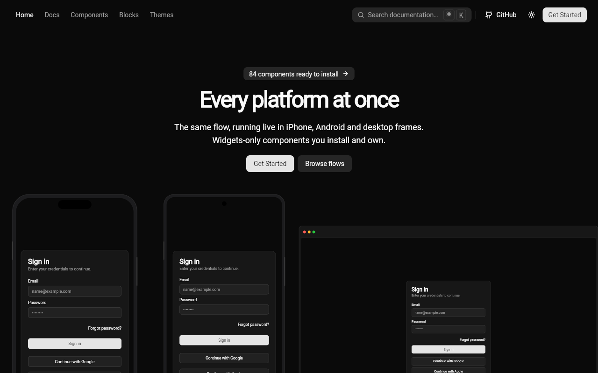
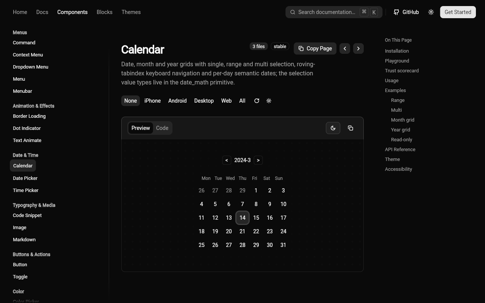
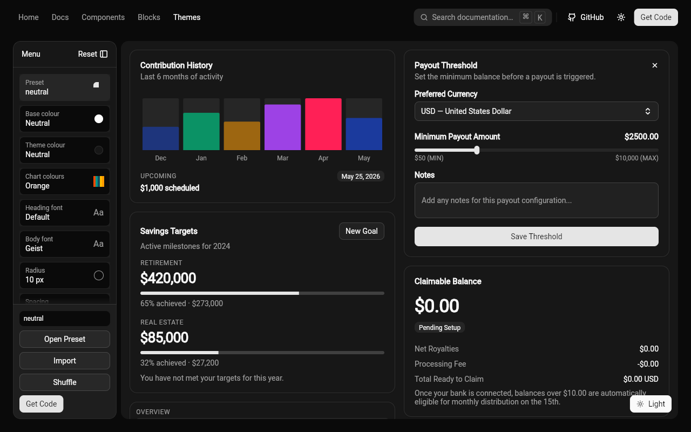
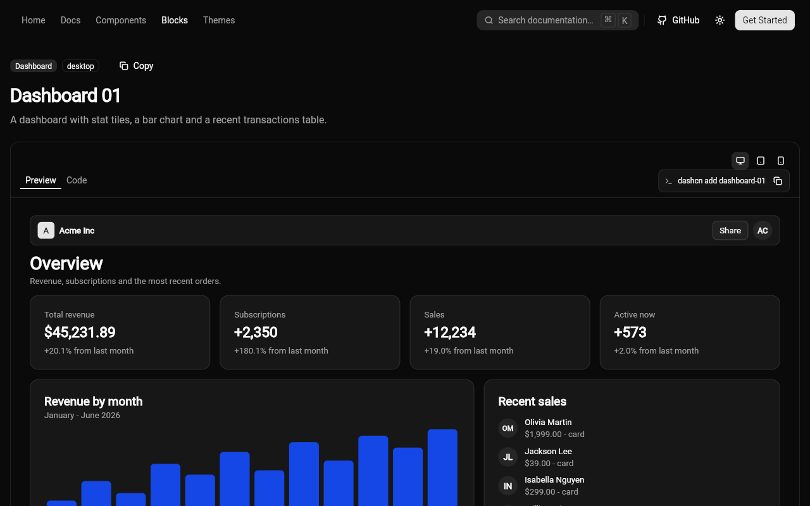

<div align="center">

<picture>
  <source media="(prefers-color-scheme: dark)" srcset="brand/svg/lockup-on-dark.svg">
  
</picture>

**A widgets-only Flutter design system — themed components, blocks, and presets, without Material or Cupertino.**

[](https://pub.dev/packages/dashcn)
[](https://pub.dev/packages/dashcn_cli)
[](https://github.com/mibrar-dev/dashcn/actions/workflows/ci.yml)
[](https://github.com/mibrar-dev/dashcn/actions/workflows/docs-deploy.yml)
[](license.md)
[](https://flutter.dev)

[Website](https://mibrar-dev.github.io/dashcn/) ·
[Docs](https://mibrar-dev.github.io/dashcn/#/docs/installation) ·
[pub.dev](https://pub.dev/packages/dashcn) ·
[CLI](https://github.com/mibrar-dev/dashcn_cli) ·
[Instructions](INSTRUCTIONS.md) ·
[Contributing](REGISTRY_CONTRIBUTING.md)

</div>

## Showcase

| | |
|---|---|
| **Home** — the live Widget Catalog | **Components** — every component with live previews |
| **Themes** — 43 presets, light + dark | **Blocks** — composed, installable screens |

Screenshots of the [live site](https://mibrar-dev.github.io/dashcn/)
(`#/` · `#/docs/components/calendar` · `#/themes` · `#/blocks/dashboard-01`).

## Why dashcn

- **Widgets-only.** No Material, no Cupertino — just `package:flutter/widgets.dart` plus theme.
- **Use it two ways.** Depend on the package, or own the sources via the CLI. Same registry, same code.
- **Themed to the token.** Every component has an isolated, replaceable theme; 43 presets ship with light + dark.
- **Copy/paste friendly.** `dashcn add button` drops real sources into `lib/ui/dashcn/` — no black box.
- **Web-theme bridge.** Import shadcn/tweakcn CSS and Tailwind v3/v4 themes; export CSS, Tailwind, W3C DTCG, JSON, or Dart.
- **Docs that run.** Device frames, live props playground, trust scorecards, and Theme Studio on the site.

## Quick start

**As a package:**

```bash
flutter pub add dashcn
```

```dart
import 'package:dashcn/dashcn.dart';
import 'package:flutter/widgets.dart';

void main() {
  runApp(DashcnApp(home: Button(onPressed: () {}, child: const Text('Hello dashcn'))));
}
```

Leaner imports per layer or per component:

```dart
import 'package:dashcn/theme.dart';
import 'package:dashcn/components/button.dart';
```

**As owned code:**

```bash
dart pub global activate dashcn_cli
dashcn init
dashcn add button
```

This copies sources into `lib/ui/dashcn/`. `dashcn eject button` turns a
package import into owned code later. See “Package or own the code?” on the
[docs site](https://mibrar-dev.github.io/dashcn/).

## What's inside

| Layer | Count | Notes |
|---|---|---|
| Components | 119 | `dashcn/lib/src/components/` — buttons, forms, overlays, navigation, … |
| Blocks | 16 | Composed sections/screens (`dashboard-01`, `login-01`, …) |
| Flows | 5 | Multi-screen: `auth-01`, `chat-01`, `checkout-01`, `onboarding-01`, `settings-01` |
| App starters | 3 | `dashcn create saas\|chat\|shop` |
| Theme presets | 43 | Light + dark, tweakcn/shadcn-compatible tokens |

Layers run foundation → theme → primitives → components → blocks, with a
one-way dependency rule (enforced in CI).

## CLI cheatsheet

```bash
dashcn init                    # set up lib/ui/dashcn/ in your app
dashcn add button              # copy one component's sources
dashcn add button --package    # …or depend on the package instead
dashcn eject button            # turn a package import into owned code
dashcn create saas my_app      # starters: saas | chat | shop
dashcn theme import theme.css  # import shadcn/tweakcn CSS, Tailwind v3/v4
dashcn theme export --format css|tailwind|dtcg|json|dart
dashcn doctor                   # diagnose your setup
```

Full reference: `dashcn --help` and the
[CLI repo](https://github.com/mibrar-dev/dashcn_cli).

## Theming

Wrap with `DashcnApp` (or `Theme`) and pick a preset; components read it
via `Theme.of(context)`. Re-theme a single component by replacing its one
user file (e.g. `button_theme.dart`) — no multi-file edits. Bring web
themes with `dashcn theme import`, share them back with
`dashcn theme export`, or tune visually in Theme Studio on the docs site.

## Repository layout

| Path | What |
|---|---|
| `dashcn/` | The `dashcn` package: sources, tests, generators |
| `docs/` | Flutter web docs app (the Widget Catalog) |
| `brand/` | Logo kit (SVG sources) |
| `rearch/` | Internal agent working area — plans, reports, QA gate (not shipped) |

The CLI (`dashcn_cli`) lives in
[`mibrar-dev/dashcn_cli`](https://github.com/mibrar-dev/dashcn_cli) and
installs from this repo's registry.

## Development

Start at [`INSTRUCTIONS.md`](INSTRUCTIONS.md): prerequisites
(Flutter 3.47.x), layers, generators with `--check`, the QA gate
(`bash rearch/qa_gate.sh`), docs sync, CI, and releasing.

## Contributing

To add or change a component or block — files to create, `meta.json`
fields, the preview contract, theming, naming rules, tests, docs sync,
and the PR checklist — see
[`REGISTRY_CONTRIBUTING.md`](REGISTRY_CONTRIBUTING.md).

## Attribution

Inspired by and partially derived from
[shadcn_flutter](https://github.com/sunarya-thito/shadcn_flutter) by
Sunarya Thito (BSD 3-Clause; copy in `licenses/`).

## License

MIT — see [`license.md`](license.md). Third-party code keeps its original
terms; see `licenses/`.
