# QA1 Report: Docs Usage Table Fit & Raw Markup (PR 62, real-font build)

- **Branch**: `fix/docs-usage-switcher`
- **Worktree**: `/Users/ibrar/Desktop/infinora.noworkspace/shadcn_copy_paste/dashcn-w-docsusage`
- **Date**: 2026-10-23
- **Build**: `cd docs && flutter build web --release --base-href /`, served with SPA fallback on `http://127.0.0.1:8765`, screenshotted with `agent-browser` (real bundled Geist fonts, not widget-test box fonts)
- **Co-Authored-By**: Claude Opus 5.5 <noreply@anthropic.com>

## 1. Orchestrator findings addressed

### 1.1 Key parameters table clipped at right edge
- **Before**: `TypesetTable` used fixed column widths (160/180/200/200 = 740 px + 32 px padding) inside a horizontal `SingleChildScrollView`. Article width is 640 px, so `Description` was cut (`"Button conte..."`, `"Visual varian..."`).
- **After** (`docs/lib/widgets/typeset_tables.dart`):
  - `TypesetTable` uses `LayoutBuilder`. Below 560 px it stacks each row as a labelled block (bordered card with Parameter/Type/Default/Description labels). At/above 560 px it renders a single `Table` that fits the incoming width.
  - Leading columns size to content with caps (Parameter 140, Type 200, Default 180) via `MinColumnWidth(IntrinsicColumnWidth(), FixedColumnWidth(cap))`. Last column is `FlexColumnWidth(1)` and wraps onto several lines.
  - Cell padding: 16 px outer, 8 px inner gaps; header 10 px vertical, body 12 px vertical; 1 px bottom rules kept.
  - Result at 1280 px width (article 640 px): Description takes remaining width and wraps (2–6 lines for `onPressedAsync`), nothing clipped. At 375 px width (article ~327 px): stacked blocks, no horizontal scroll needed, no clipping.

### 1.2 Raw markup in descriptions
- **Before**: `TypesetCell(text: param.doc)` rendered via plain `Text`, so `` `Text` `` and `[ButtonVariant.primary]` showed raw backticks/brackets.
- **After**:
  - `docs/lib/widgets/typeset.dart`: new `docsDocSpans()` parses doc comments: `` `code` `` → inline code chip, `[Ref]` → inline code chip with brackets stripped, newlines collapse to spaces, empty → `—`. No raw `` ` ``/`[`/`]` reach the UI.
  - `docs/lib/widgets/typeset_tables.dart`: non-mono cells render via `Text.rich(TextSpan(children: docsDocSpans(...)))`. Mono cells (Parameter/Type/Default) stay plain mono.
  - `docs/lib/widgets/component_sections.dart`: API summary now uses `TypesetParagraph.rich(docsDocSpans(...))` instead of plain text.
  - Test (`docs/test/docs_usage_switcher_test.dart`): asserts no `Text`/`TextSpan` in the usage table contains `` ` ``, and non-mono plain text contains no `[`/`]` (chips are `WidgetSpan`s).

## 2. Real-font verification method
- `flutter build web --release`, SPA server (`/docs/components/<id>` fallback to `index.html`), `agent-browser`:
  - `set viewport 1280 2400` / `375 3200` (tall viewports capture Usage in one shot; widths are the tested 1280/375; Flutter web scroll is internal so window scroll cannot reach Usage)
  - `set media light` / `dark`, `open http://127.0.0.1:8765/docs/components/<button|popup|slider>`, `wait 8000` (12000 for retake), `screenshot qa1/<name>.png`
- 12 captures in `scratchpad/ui/round2/docsusage/qa1/`:
  - Button / Popup / Slider × light / dark × 1280 / 375

## 3. Captures

### Button 1280 light (real fonts)
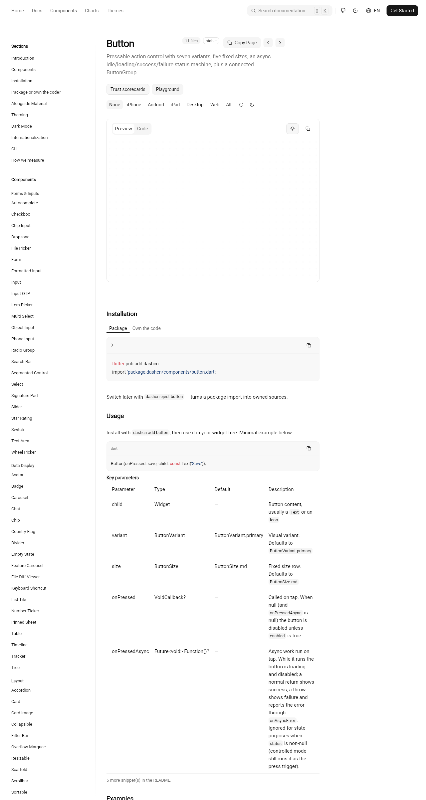
- `child`: “Button content, usually a `Text` or an `Icon`.” → chips `Text`, `Icon`, wraps to 3 lines, fits.
- `variant`: Default `ButtonVariant.primary` on one line (cap 180 fix), Description “Visual variant. Defaults to `ButtonVariant.primary`.” with chip, no brackets.
- `onPressedAsync`: Type `Future<void> Function()?` fits, Description wraps to 8 lines, chips `onAsyncError`, `status`, no raw symbols.

### Button 1280 dark
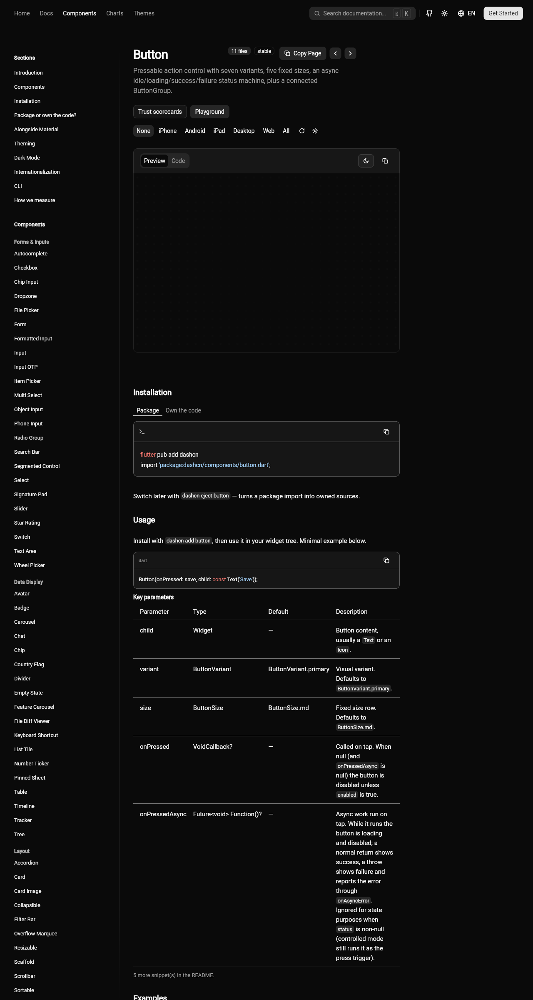
- Same table in dark, fits, wraps, chips, no clipping, no raw markup.

### Popup 1280 light
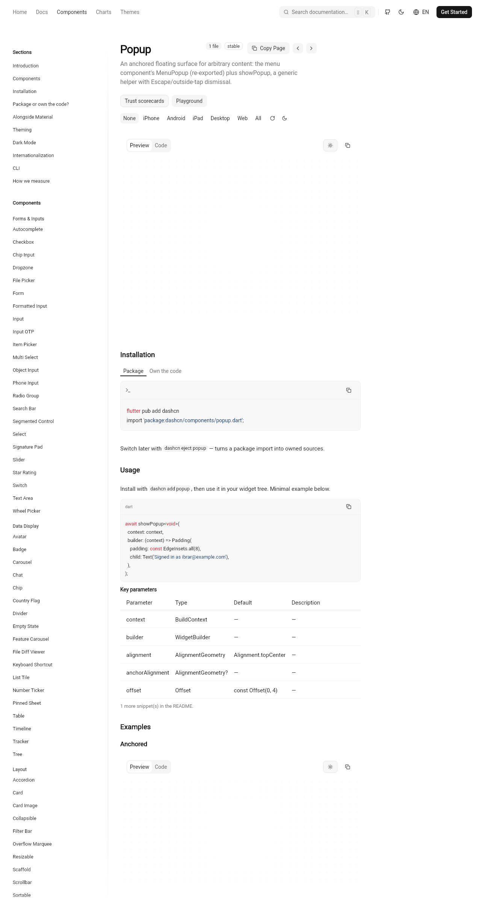
- Key params (`context`, `builder`, `alignment`, `anchorAlignment`, `offset`) fit; empty docs render `—`; no raw markup; no clipping.

### Popup 1280 dark
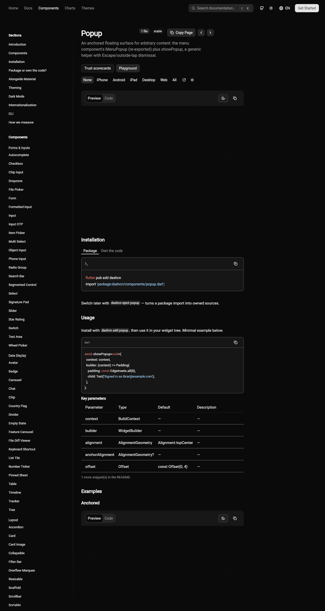
- Same in dark, fits, `—` placeholders, no clipping.

### Slider 1280 light
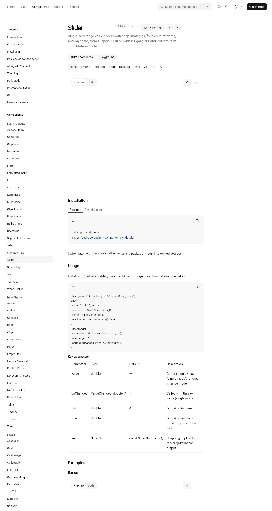
- `max`: “Domain maximum; must be greater than `min`.” → chip `min`, wraps, no brackets. `snap` Default `const SliderSnap.none()` fits. No clipping.

### Slider 1280 dark (retake, 12 s wait)
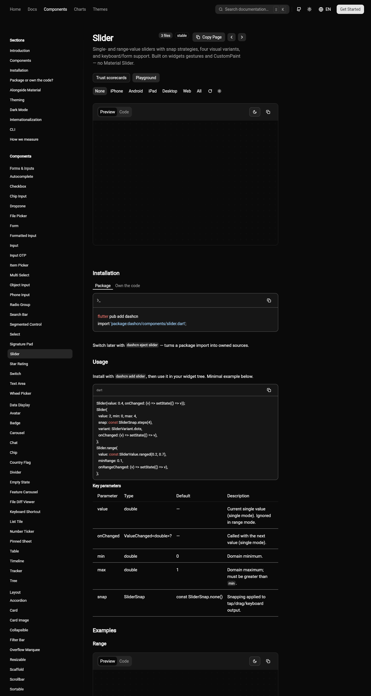
- First attempt rendered black (deferred preview not ready at 8 s); retake with 12 s wait loaded fully. Table fits, chips, no raw markup.

### Button 375 light (stacked)
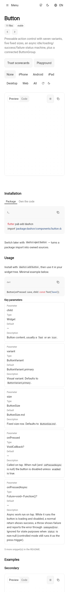
- Stacked blocks with Parameter/Type/Default/Description labels, bordered cards, chips `Text`, `Icon`, `ButtonVariant.primary`, etc. No horizontal scroll, nothing clipped.

### Button 375 dark (stacked)
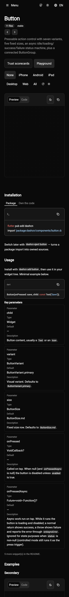
- Same stacked blocks in dark, fits 375 width, no clipping, no raw symbols.

### Popup 375 light (stacked)
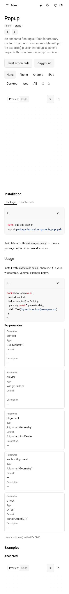
- Stacked blocks, `—` descriptions, fits, no scroll.

### Popup 375 dark (stacked)
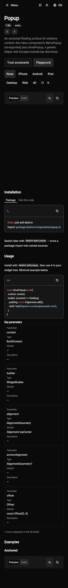
- Same in dark, fits.

### Slider 375 light (stacked)
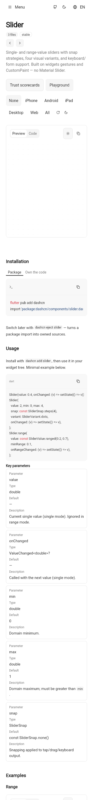
- Stacked blocks, chip `min`, fits, no raw brackets.

### Slider 375 dark (stacked)
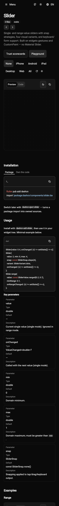
- Same in dark, fits, chips, no clipping.

## 4. Gate results
- `dart format` (touched files): 0 changed
- `dart analyze docs` / `dart analyze dashcn`: no issues
- `dart run tool/gen_docs_data.dart --check`: up to date (18 files)
- `tool/sync_registry.sh --check`: mirror up to date
- Generators re-run: `gen_scorecards`, `gen_registry_manifest`, `gen_exports`, `gen_previews_test` (scorecard timing noise reverted)
- Tests (one at a time, all pass):
  - `docs_usage_switcher_test` 5/5 (updated divider check for `TableRow` + raw-markup check)
  - `component_page_test` 13/13, `website_i18n_test` 8/8, `responsive_test` 5/5
  - `focus_test` 11/11, `docs_pages_test` 10/10, `charts_pages_test` 16/16, `motion_test` 10/10
  - `p7th1_theme_everywhere_test` 6/6, `surface_rail_test` 5/5
  - `button_test` 12/12, `navigation_bar_test` 22/22
- `flutter build web --release`: Built `build/web` (37–38 s)

## 5. Files changed
- `docs/lib/widgets/typeset.dart`: `docsDocSpans()` parser
- `docs/lib/widgets/typeset_tables.dart`: responsive fitted/stacked `TypesetTable`, rich cells
- `docs/lib/widgets/component_sections.dart`: rich API summary
- `docs/test/docs_usage_switcher_test.dart`: divider check accepts `Table`/`TableRow`, raw-markup assertions
- `scratchpad/ui/round2/docsusage/qa1/` (new): 12 real-font PNGs
- `scratchpad/ui/round2/docsusage/QA1-REPORT.md` (this file)
